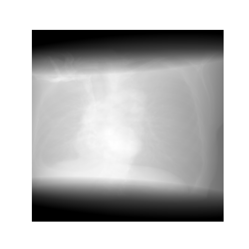
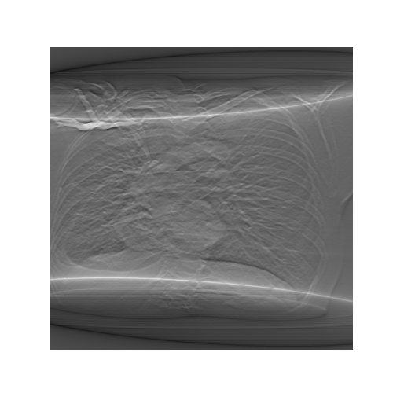
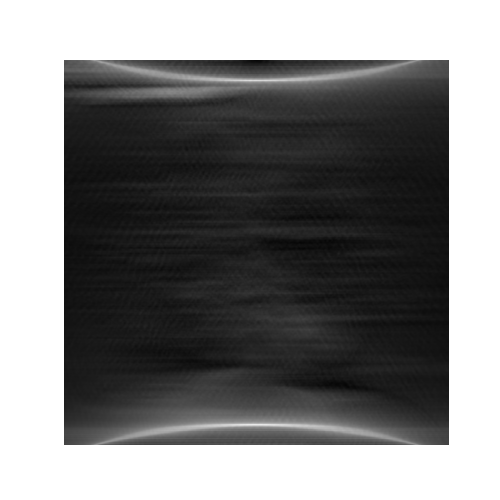
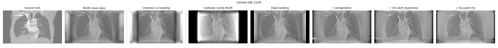
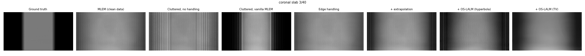
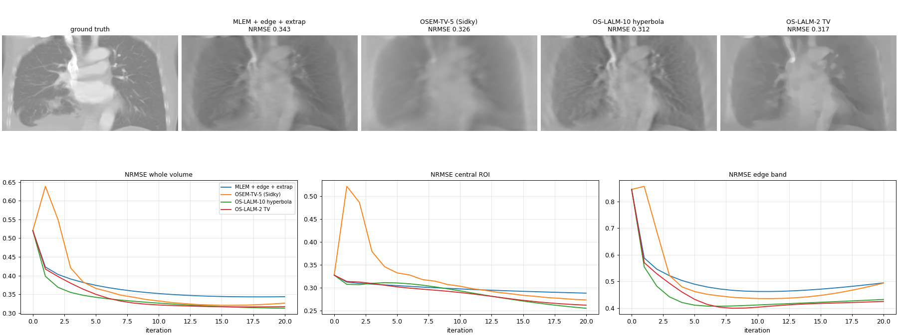
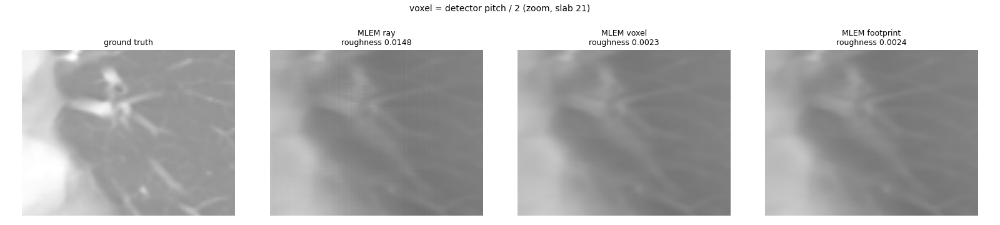

# medical-img-proc


## Project Structure
```
.
├── cuda-files
│   ├── backprojection.cu
│   ├── mlem.cu                 # MLEM / OSEM / OS-LALM / TV kernels, ray, voxel and footprint projectors
│   └── projection.cu
├── examples
│   ├── configs                 # JSON configs for the reconstruction example
│   │   ├── compare_all.json
│   │   ├── recommended.json
│   │   └── recommended_tv.json
│   ├── mlem_reconstruction_example.py
│   └── x_ray_simulator_example.py
├── misc                        # README figures
├── poetry.lock
├── pyproject.toml
├── README.md
├── utils
│   ├── CudaWrapper.py
│   ├── DicomCTParser.py
│   ├── __init__.py
│   ├── Logger.py
│   ├── MLEM.py                 # GPU-resident iterative reconstruction
│   ├── TomoFilter.py
│   └── VolumeVisualizer.py
├── uv.lock
└── uv.toml
```

## Install dependencies
1. As a prequisite, you need to install Cuda Driver with Toolkit libraries. Then you need to add Cuda libraries to the path.
```bash
 export PATH=/usr/local/cuda/bin:$PATH
 export LD_LIBRARY_PATH=/usr/local/cuda/lib64:$LD_LIBRARY_PATH
 ```

2. To install dependencies, you can use pip or uv environment manager. To install dependencies using pip, run the following command:
```bash
uv pip install -r requirements.txt
```

# Downloading sample data (e.g.: Lung HR-CT)
1. Downloading sample <b>Chest HR CT</b> data e.g. from the following source from cancer imaging archive:
https://www.cancerimagingarchive.net/collection/lung-pet-ct-dx/ [1] <br>
For downloading from he Cancer Imaging Archive, you also need data retriever tool:
https://wiki.cancerimagingarchive.net/display/NBIA/NBIA+Data+Retriever+Command-Line+Interface+Guide
2. you can download CT collection with the following command e.g.: <br>
`/opt/nbia-data-retriever/bin/nbia-data-retriever --cli Lung-PET-CT-Dx-NBIA-Manifest-122220.tcia -d ./data/`

[1] Li, P., Wang, S., Li, T., Lu, J., HuangFu, Y., & Wang, D. (2020). A Large-Scale CT and PET/CT Dataset for Lung Cancer Diagnosis (Lung-PET-CT-Dx) [Data set]. The Cancer Imaging Archive. https://doi.org/10.7937/TCIA.2020.NNC2-0461

# Projection and Backprojection

## Overview
This project implements fast, GPU-accelerated X-ray projection and backprojection for 3D medical CT volumes using CUDA. These operations are fundamental to computed tomography (CT) simulation and reconstruction.

- **Projection** simulates the acquisition of X-ray images (sinograms) from a 3D volume by integrating attenuation along rays from a moving source to a detector. This is used to generate synthetic X-ray or CT projection data from volumetric scans.
- **Backprojection** reconstructs a 3D volume from a set of 2D projections (sinograms) by "smearing" the measured values back along the original ray paths. This is a key step in filtered backprojection (FBP) CT reconstruction.

## CUDA Implementation
Both operations are implemented as custom CUDA kernels for high performance. The code supports multiple modes:
- **Mode 0:** Nearest-neighbour interpolation
- **Mode 1:** Bilinear interpolation
- **Mode 2:** Hardware-accelerated trilinear interpolation using CUDA 3D textures (recommended for best quality and speed)

The main Python interfaces are:
- `Projector` (in `utils/CudaWrapper.py`):
    - Method: `project(volume)`
    - Input: 3D numpy array (volume)
    - Output: 3D numpy array (sinogram: [nproj, nv, nu])
- `Backprojector` (in `utils/CudaWrapper.py`):
    - Method: `backproject(sinogram)`
    - Input: 3D numpy array (sinogram)
    - Output: 3D numpy array (reconstructed volume)

## Example Usage
See `examples/x_ray_simulator_example.py` for a full pipeline:
1. Load and preprocess a CT volume
2. Simulate X-ray projections using `Projector` 

3. (Optionally) Filter the projections (e.g., with an 1D Hamming filter)

4. Reconstruct the volume using `Backprojector`


### Notes
Physical Extents:

Adjust oxb, oyb, and ozb based on your actual DICOM metadata (e.g., PixelSpacing and SliceThickness).
The values above are placeholders and may need tuning. In the example of x_ray_simulator_example.py, the slice reconstruction can be done with 'axial', 'coronal' and sagittal' views. It defines the appropriate transpose order, physical extents, source/detector geometry.

# Iterative reconstruction: MLEM, OSEM, OS-LALM and TV

`utils/MLEM.py` + `cuda-files/mlem.cu`. The geometry convention is the same as `Projector` / `Backprojector`. All iteration buffers (measured data, ray weights, forward projection, estimate, sensitivity, dual variables) stay in GPU memory; data is transferred only on upload and download.

Weighted MLEM update with ray weights `w` (edge/clutter handling) and an optional additive term `b`:

```
x <- x / (A^T w) * A^T( w * y / (A x + b) )
```

| Variant | Description |
|---|---|
| `vanilla` | the initial MLEM version: coverage-scaled ratio and full-coverage sensitivity, no clutter handling (baseline) |
| `mlem` | weighted MLEM (EM on the w-weighted Poisson likelihood) |
| `osem` (`n_subsets`) | ordered subsets (interleaved projections), faster convergence per pass |
| `osem-tv` (`tv=dict(a, n_grad, a_red, wz)`) | OSEM data step + TV steepest-descent steps with adaptive step size (Sidky, Kao & Pan) |
| `os-lalm` (`n_subsets`, `lalm=dict(prior, ...)`) | penalised weighted least squares solved with OS-LALM (Nien & Fessler); `prior='hyperbola'` (edge-preserving) or `prior='tv'` (exact isotropic TV) |

| Back-projector (`backprojector=`) | Description |
|---|---|
| `voxel` (default) | voxel-driven gather, pairs with the ray-driven forward projector; adjoint mismatch ~1e-6, fastest |
| `ray` | exact adjoint of the ray-driven forward projector (atomic scatter); adjoint mismatch ~1e-10 |
| `footprint` | separable-footprint / distance-driven **matched pair** (forward + back, both gather, no atomics); models finite voxel and detector-cell size |

Projection-edge clutter handling (`EdgeHandling.proposed()`):
- adaptive per-projection detection of corrupted border lines (collimator shadow / scatter bands, dead and saturated rows) -> zero weight
- per-pixel outlier rejection (hot pixels) -> zero weight
- sensitivity FOV mask: voxels with `A^T w < 2% max` are frozen and output as 0
- min-coverage guard: rays with less than 2% of their path inside the volume get zero weight
- optional (`EdgeHandling.truncated()`): down-weighting of rays that leave through the lateral volume faces (only useful when the object is truncated by the reconstruction volume)

Because the same weights enter the sensitivity term, this is still a proper EM algorithm (unlike the vanilla version, which only scaled the ratio).

## Running the example

`examples/mlem_reconstruction_example.py` uses the same coronal set-up as the simulator: it simulates 20 projections with `Projector`, injects synthetic border clutter, reconstructs, and evaluates against the ground truth resampled on the reconstruction grid. Settings come from built-in defaults, overridden by a JSON config (`--config`) and then by command-line flags.

```bash
# recommended pipeline only (edge handling + sqrt extrapolation + OS-LALM-10, ~10 s of reconstruction)
python examples/mlem_reconstruction_example.py --config examples/configs/recommended.json

# recommended pipeline with the exact TV prior (OS-LALM-2 TV, best edge band, ~3x slower)
python examples/mlem_reconstruction_example.py --config examples/configs/recommended_tv.json

# all variants side by side + README figures in misc/ (~4 min on an RTX 3060)
python examples/mlem_reconstruction_example.py --config examples/configs/compare_all.json

# command-line overrides, e.g. plain MLEM without clutter and without extrapolation
python examples/mlem_reconstruction_example.py --variant mlem --subsets 1 --n-iter 30 --no-clutter --no-extrapolation

# show the effective configuration
python examples/mlem_reconstruction_example.py --config examples/configs/recommended.json --print-config
```

Recommended configuration (`examples/configs/recommended.json`):

```json
{
  "mode": "recommended",
  "input_path": "./data/Lung-Pet-CT-Dx/Lung_Dx-A0018/07-24-2008-lungc-69037/301.000000-1.25mm-74521/1",
  "out_dir": "./results/mlem",
  "plane": "coronal",
  "num_projections": 20,
  "detector_px": 1512,
  "bin": 2,
  "recon_vz": 40,
  "n_iter": 20,
  "add_clutter": true,
  "edge_handling": {"border_px": 2, "auto_detect": true, "outlier_k": 8.0,
                    "sens_threshold": 0.02, "coverage_min": 0.02},
  "extrapolation": {"enabled": true, "pad_px": 160, "shape": "sqrt", "w_ext": 0.3},
  "reconstruction": {"variant": "os-lalm", "backprojector": "voxel", "n_subsets": 10,
                     "lalm": {"prior": "hyperbola", "beta": 1.0, "delta": 0.2}}
}
```

For the TV prior use `"n_subsets": 2` and `"lalm": {"prior": "tv", "tv_lambda": 0.01, "tv_wz": 1.0, "tv_inner": 50}` (`recommended_tv.json`). The `recommended` mode writes `reconstruction.npy`, `reconstruction_slabs.png` and `metrics_recommended.json` to `out_dir`. The `compare` mode writes `metrics.json`, `convergence.png` and `edge_weights.png`, plus the figures below in `misc/`.

## Results

20 projections, 756² binned detector, 40x515x911 volume, 20 iterations, RTX 3060. NRMSE is against the ground truth averaged per slab:

| run | time | NRMSE | central | edge band | proj. err vs clean |
|---|---|---|---|---|---|
| clean, MLEM ray | 5.2 s | 0.447 | 0.309 | 0.647 | 0.008 |
| clean, MLEM voxel | 3.0 s | 0.447 | 0.309 | 0.647 | 0.008 |
| clean, MLEM footprint | 11.7 s | 0.447 | 0.309 | 0.647 | 0.008 |
| clean, OSEM-5 voxel | 3.0 s | 0.442 | 0.320 | 0.633 | 0.005 |
| clean, vanilla MLEM (initial version) | 3.0 s | 0.627 | 0.304 | 0.722 | 0.178 |
| clutter, MLEM voxel (no handling) | 2.8 s | 1.981 | 0.342 | 4.124 | 0.045 |
| clutter, vanilla MLEM (initial version) | 2.8 s | 1.605 | 0.303 | 1.141 | 0.177 |
| clutter, MLEM voxel + fixed 40 px crop | 2.8 s | 0.508 | 0.320 | 0.810 | 0.010 |
| clutter, MLEM voxel + edge handling | 2.8 s | 0.491 | 0.319 | 0.723 | 0.010 |
| clutter, OSEM-5 voxel + edge handling | 2.9 s | 0.482 | 0.332 | 0.698 | 0.006 |
| clutter, MLEM voxel + edge + sqrt extrapolation | 3.6 s | 0.343 | 0.288 | 0.494 | 0.011 |
| clutter, OSEM-TV-5 + edge + extrapolation | 4.9 s | 0.326 | 0.273 | 0.493 | 0.014 |
| clutter, **OS-LALM-10 hyperbola + edge + extrapolation** | 5.2 s | **0.312** | **0.255** | 0.432 | **0.005** |
| clutter, **OS-LALM-2 TV + edge + extrapolation** | 13.8 s | 0.317 | 0.262 | **0.424** | 0.007 |

Side-by-side comparison of a reconstructed coronal slab (20 iterations):


Sweep through the reconstructed slabs (left to right: ground truth, MLEM on clean data, MLEM on cluttered data without handling, vanilla MLEM, MLEM with edge handling, + sqrt detector extrapolation, + OS-LALM with the hyperbola prior, + OS-LALM with the TV prior):


OS-LALM and TV reconstructions (zoom on the central region, cluttered data, edge handling + extrapolation) and their convergence:


## Projectors

**Separable-footprint projector pair** (`backprojector='footprint'`, after Long, Fessler & Balter 2010 and its GPU version by Meng & Fessler):
- All slabs are parallel to the detector, so on every plane both the voxel and the detector cell are axis-aligned rectangles and the footprint is *exactly* separable.
- The depth extent (the trapezoid in `u` for oblique rays) is integrated with a per-projection number of sub-planes (8–19 here).
- Forward and back projection evaluate the same weights `a_ij = (zv/nsub)·sec θ·(ox/du)·(oy/dv)` as gathers, giving a matched pair without atomics. Adjoint test: 3.6e-6 (float rounding).

When the voxel size equals the detector pitch, the box-overlap weights reduce *exactly* to bilinear weights. In the main example the footprint pair therefore gives the same results as ray/voxel at about 4x the cost. It only differs when voxel and detector sampling are mismatched. Projector study with voxel = pitch/2 (clean data, MLEM 20 it):

| back-projector | adjoint mismatch | NRMSE | central | edge | roughness | time |
|---|---|---|---|---|---|---|
| ray (exact adjoint, atomics) | 4.3e-10 | 0.448 | 0.313 | 0.646 | 0.0148 | 10.5 s |
| voxel (gather) | 2.9e-5 | 0.447 | 0.309 | 0.646 | 0.0023 | 9.2 s |
| footprint pair | 3.6e-6 | 0.447 | 0.309 | 0.646 | 0.0024 | 51.2 s |



The ray-driven adjoint leaves a moiré texture (6x roughness) where rays are sparser than voxels. The footprint pair and the voxel back-projector avoid it, so the **voxel back-projector stays the default**. Use the footprint pair when a strictly matched, cell-integrating model is needed, e.g. for detector-blur modelling, objects finer than the voxel, or convergence-sensitive solvers.

## Regularised solvers: OS-LALM and total variation

**OS-LALM** (`variant='os-lalm'`, Nien & Fessler 2015, arXiv:1402.4381) solves the penalised weighted least-squares problem on the line integrals

```
min_{x>=0} 1/2 ||y - (A x + b)||_W^2 + R(x),   W = ray weights (edge handling)
hyperbola: R(x) = beta * sum_neighbours delta^2 (sqrt(1 + ((x_j - x_k)/delta)^2) - 1)
TV:        R(x) = lambda * sum_j sqrt((D_x x)_j^2 + (D_y x)_j^2 + (w_z D_z x)_j^2)
```

It uses:
- the SQS diagonal majorizer `D = A^T W A 1`;
- ordered subsets in bit-reversal order;
- the deterministic downward continuation of `rho` with adaptive restart.

The inner denoising step is one SQS step for the hyperbola. For TV it is the exact weighted TV proximal problem `min_{x>=0} 1/2||x - z||^2_{rho D} + lambda TV(x)`, solved with warm-started primal-dual iterations on the GPU.

Total variation ideas adopted from the papers in `/KB`:

| Source | Idea | Status here |
|---|---|---|
| Sidky, Kao & Pan, arXiv:0904.4495 (TV for few-view / limited-angle divergent-beam CT) | alternate the data step with `n_grad` TV steepest-descent steps whose length is `a · d_A`, `d_A` = image change of the data step, so TV never dominates the data | **implemented** as `variant='osem-tv'` (EM instead of ART as the data step, TV between slabs via `wz`) |
| Xiao & Yang, *A fast algorithm for TV image reconstruction from random projections* (FTVCS) | split `w = Du`, linearise the data term with a proximal term, exact TV via shrinkage | **implemented** as the TV inner step of OS-LALM: the linearised data term is the OS-LALM majorizer; the shrinkage appears as its dual projection `\|p\| <= lambda`. The FFT u-step is not used because `A^T A` is not circulant here |
| Jia et al., arXiv:1002.3675 (GPU cone-beam CT via TV) | forward-backward splitting: data gradient step + TV denoising step, GPU-friendly voxel-driven back-projection, multi-grid | the forward-backward structure is the OS-LALM TV variant above; the voxel-driven back-projection is `backprojector='voxel'`. Multi-grid (coarse-to-fine initialisation) is not implemented |

Findings (cluttered data, edge handling + extrapolation, 20 iterations):
- **Hyperbola, 10 subsets** is the best overall (NRMSE 0.312) and the fastest regularised solver. `beta=1.0` is needed for stability; without a prior PWLS with 10 subsets diverges after 1–3 iterations.
- **Exact TV** gives the best edge band (0.424 with 2 subsets, 0.404 with 1 subset). Compared at equal subsets it is clearly better than the hyperbola (2 subsets: 0.317 vs 0.347). TV has no curvature for small differences, so it cannot stabilise many subsets: with 5–10 subsets it diverges. It also needs a converged prox: with 10 inner iterations the result no longer depends on `lambda`, so 50 are used.
- **OSEM-TV (Sidky)** with between-slab TV (`a=3, wz=1`) beats MLEM everywhere (0.326 vs 0.343) at almost no extra cost. With in-plane TV only it gives the lowest central-ROI error of all (0.220) but degrades the edges.

## Truncation artifacts

Two different truncations cause the edge artifacts in tomosynthesis (Zhang et al. 2009):
1. **Detector truncation** (detector-boundary artifact). The object is wider than the detector, so lateral voxels are seen by only a subset of the views. This produces bright bars and staircases along the cone-beam boundaries.
2. **Volume truncation** ("glaring"). Tissue lies outside the modelled volume. Rays crossing it carry attenuation that the volume has to explain, so voxels near the boundary are overestimated. In plain MLEM, rays that only graze a volume corner (under 2% of their path inside) but have large measured values drive single corner voxels to divergence (overflow after about 10 iterations in our test).

Methods from the papers in `/KB` that are implemented here:

| Source | Method | Implementation |
|---|---|---|
| Kadrmas et al., PMB 1995 | quantitative extrapolation: polynomial fill matching edge height and slope, total attenuation `P_tot` conserved | **implemented** as `extend_detector(shape='quadratic')`. `P_tot` needs one untruncated view, and our views are all truncated, so the width comes from the slope |
| Xia et al., SPIE 2013 (refs.) | square-root / water-cylinder extrapolation | **implemented** as `extend_detector(shape='sqrt')` (default). Fill error 0.20 vs 0.47 for the quadratic |
| Zhang et al., JCAT 2009 | path-length compensation of glaring: `μ_avg·\|AB\|` for the missing outside path | **implemented** as the additive term `b`: `set_background(outside_path_background())`. It over-corrects here because the 900 mm deep outside path is not homogeneous tissue (it works for a thin compressed breast). Off by default |
| Zhang et al. | minimum-coverage guard (implicit in their thresholding) | **implemented** as `coverage_min=0.02` in `EdgeHandling.proposed()`. Excludes grazing rays and prevents the corner-voxel divergence |

Measured on the coronal example (MLEM voxel, 20 iterations, NRMSE all / central / edge):

| Volume truncation (recon FOV ±200 mm, object ±265 mm), clean data | all | central | edge |
|---|---|---|---|
| no compensation | diverges | 0.325 | diverges |
| min-coverage guard | 0.405 | 0.325 | 0.763 |
| coverage weighting (γ=2) | 0.684 | 0.316 | 1.815 |
| guard + outside-path background `b` | 0.544–0.572 | 0.437–0.457 | 0.840–0.891 |
| extended FOV (±265 mm) then cropped | **0.354** | **0.279** | **0.551** |

| Detector truncation (full FOV, cluttered data, proposed edge handling) | all | central | edge |
|---|---|---|---|
| no extrapolation | 0.491 | 0.319 | 1.198 |
| quadratic extrapolation (Kadrmas PF), `w_ext` 0.3 | 0.366 | 0.266 | 0.873 |
| sqrt extrapolation, `w_ext` 0.3 | 0.343 | 0.289 | 0.712 |
| oracle: untruncated wider detector, clean data | 0.298 | 0.290 | 0.342 |

The edge column in these two tables uses an outer-15% band in x only, so it is not comparable with the main table above.

Recommendations:
- Always keep the min-coverage guard (`edge_handling.coverage_min`, on in `examples/configs/recommended.json`).
- Use **sqrt extrapolation** onto a virtually wider detector against detector truncation (`extrapolation`, on in the recommended config). The extrapolated rays get a low weight, and the slope is smoothed over neighbouring rows to avoid horizontal streaks.
- Reconstruct on an **extended FOV** whenever the object may extend beyond the volume, and crop afterwards. This is a geometry choice (the `xs`/`ys` extent of `TomoGeometry`), not a config switch.
- Reconstruct with OS-LALM (hyperbola, 10 subsets) for the best overall result, or OS-LALM-TV (2 subsets) for the best edge band. Launch commands are in [Running the example](#running-the-example).

## Applications
- Simulating X-ray/CT acquisition for algorithm development
- Testing and benchmarking CT reconstruction methods
- Educational demonstrations of tomographic principles
